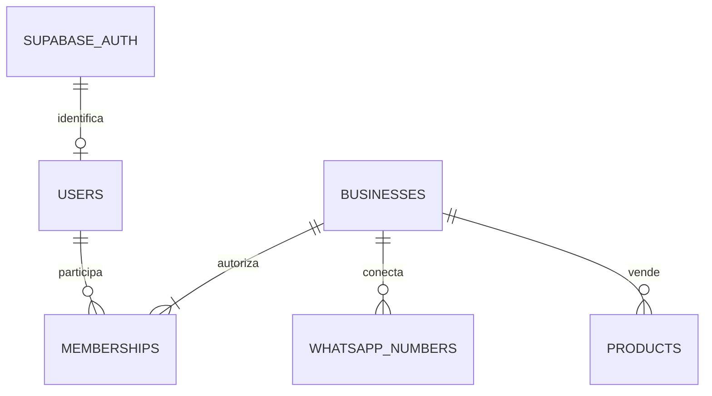

# Base de datos

PostgreSQL. Esquema privado app, accesible desde NestJS. Supabase Auth administra identidades y credenciales; app.users guarda el perfil de aplicación, sin contraseñas.



| Tabla implementada | Campos principales / restricciones |
| --- | --- |
| users | id UUID, auth_user_id UUID único, email opcional. La identidad se obtiene del token verificado, nunca del cuerpo. |
| businesses | id, name, created_by. Crear negocio y membresía owner es una transacción. |
| memberships | Clave business_id + user_id; rol owner, admin u operator. Un usuario puede pertenecer a varios negocios. |
| whatsapp_numbers | business_id, teléfono E.164 único, identificador Meta único opcional, estado. Varios números por negocio. |
| products | business_id, nombre, precio decimal no negativo, moneda COP, activo. Varios productos por negocio. |
| schema_migrations | Versión, checksum y fecha. No editar una migración ya aplicada. |

## Aislamiento
- Todas las consultas de negocios se filtran por la membresía del usuario autenticado.
- Productos y números incluyen clave única business_id + id para permitir referencias compuestas de futuras tablas y evitar cruces entre negocios.
- RLS está activado sin políticas de acceso directo. El esquema no se expone al navegador.
- El propietario de tablas y los roles privilegiados pueden eludir RLS: las comprobaciones de NestJS siguen siendo obligatorias. No habilitar acceso cliente a app sin diseñar políticas.
- El comprador por WhatsApp se modelará como contacto; es distinto del cliente que contrata el SaaS y sí inicia sesión.

## Modelo posterior, aún sin tablas
```text
Negocio
├── Contactos → conversaciones → mensajes
├── Pedidos → detalles con nombre/precio histórico
├── Flujos → versiones publicadas → ejecuciones
└── Inbox/outbox para eventos y acciones idempotentes
Cuenta o negocio → suscripción → cobros  # Titular de facturación por decidir
```

No se ha decidido si una suscripción cubre un negocio o varios. No se implementa facturación hasta resolverlo. Variantes, stock y relaciones con transportadoras siguen fuera de esta migración.

## Migraciones
Desde la raíz, con PostgreSQL local encendido:
```bash
corepack pnpm db:migrate
```

SQL versionado en apps/api/migrations. El ejecutor usa bloqueo entre procesos, transacción por archivo y checksum. Ejecutar explícitamente antes de usar los módulos; no se migra al arrancar API o worker. No se ha aplicado nada a Supabase remoto.
