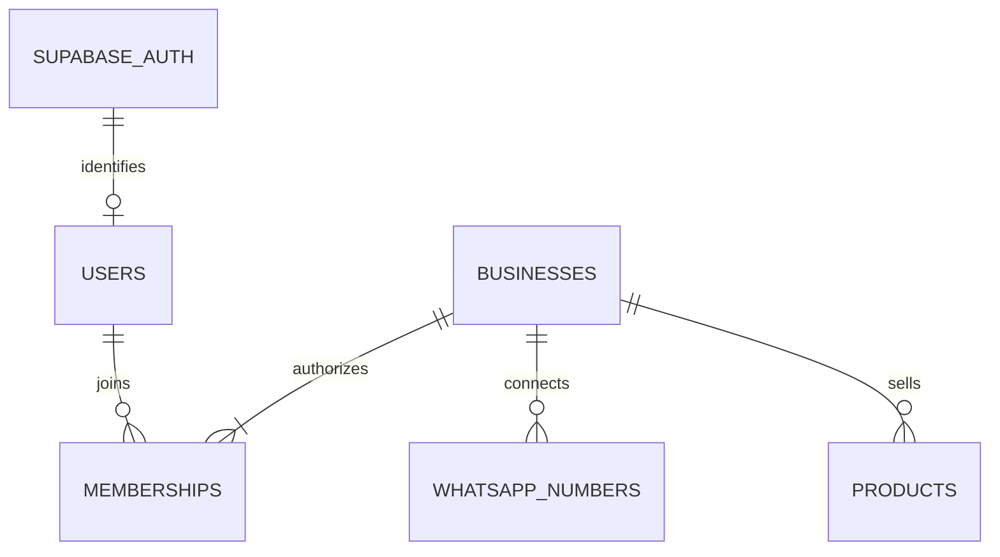

# Database

PostgreSQL uses a private app schema accessed through NestJS. Supabase Auth manages identities and credentials; app.users stores application profiles without passwords.



| Implemented table | Main fields and constraints |
| --- | --- |
| users | UUID id, unique auth_user_id, optional email. Identity comes from the verified session. |
| businesses | id, name, created_by. Business creation and owner membership share a transaction. |
| memberships | Composite business_id + user_id key; owner/admin/operator role. Users may join several businesses. |
| whatsapp_numbers | business_id, unique E.164 phone, optional unique Meta phone ID, status. Multiple numbers per business. |
| products | business_id, name, nonnegative decimal price, COP currency, active flag. Multiple products per business. |
| schema_migrations | Version, checksum, and application date. Never edit applied migrations. |
| commercial_requests | Contact/plan requests, verified auth user ID for purchases, email/phone, consent timestamp, pending/contacted/closed status. No payment credentials. |
| flows / flow_versions | Business-scoped drafts with optimistic revisions; immutable numbered publication snapshots. See [flows](flows.md). |

## Isolation
- Business queries filter by the authenticated user's membership.
- Products and phone numbers have unique business_id + id keys to support future composite foreign keys and prevent cross-business references.
- RLS is enabled without direct-access policies. The schema is not exposed to browsers.
- Table owners and privileged roles can bypass RLS. NestJS authorization remains mandatory; design policies before enabling direct client access.
- WhatsApp buyers will be contacts, distinct from SaaS customers who sign in.

## Future model: tables not implemented yet
```text
Business
├── Contacts → conversations → messages
├── Orders → items with historical name and price
├── Flows → published versions → executions
└── Inbox/outbox for idempotent events and actions
Account or business → subscription → charges  # Billing scope undecided
```

Whether one subscription covers one or several businesses remains undecided. Billing is not implemented. Product variants, stock, and carrier integrations are outside this migration.

## Migrations
From the repository root, with local PostgreSQL running:
```bash
corepack pnpm db:migrate
```

Versioned SQL lives in apps/api/migrations with locks, transactions, and checksums. Run migrations explicitly; startup does not apply them. Applied migrations 004–005 add flow publications and private WhatsApp channels, inbox, outbox, conversations, and delivery events. See [WhatsApp](whatsapp.md).

## Consultation follow-up

After migrations 002 and 003, the operator uses a trusted PostgreSQL session with app-schema access to review requests:
```sql
SELECT id, kind, email, phone, name, message, plan, created_at
FROM app.commercial_requests
WHERE status = 'pending_contact' ORDER BY created_at;
```
Record follow-up by updating that request's status to contacted or closed. There is no public lead-list endpoint or automatic notification. Restrict database access to the operator; do not expose this table through Supabase browser APIs.
